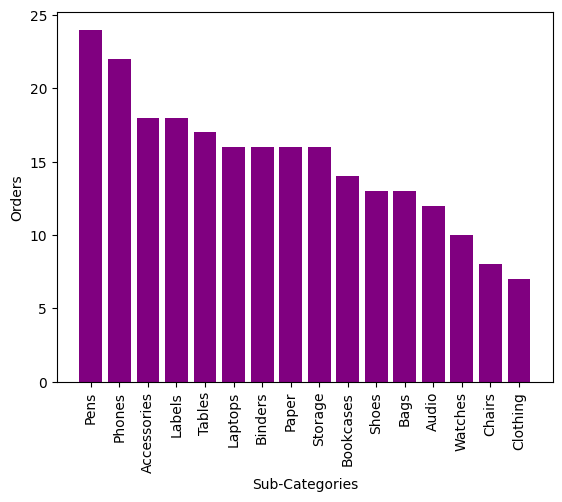
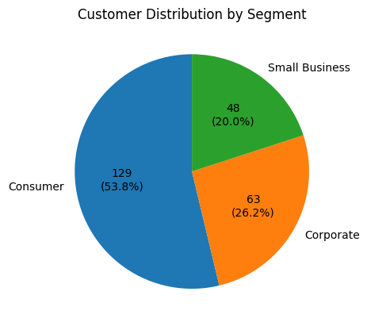
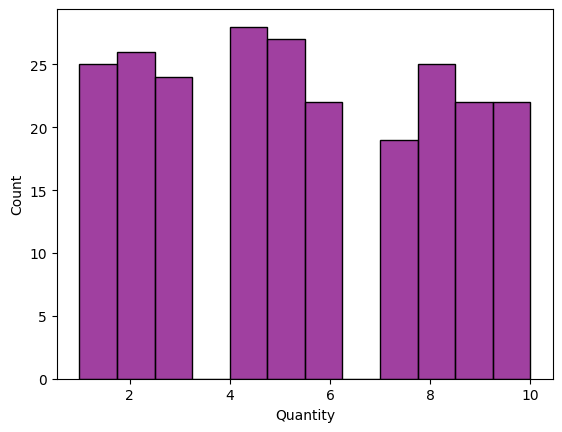
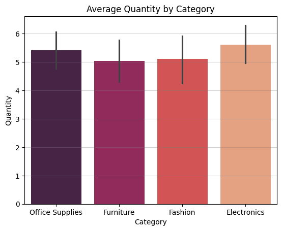
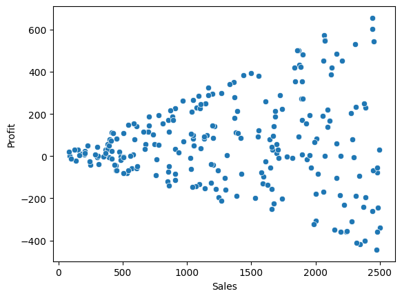
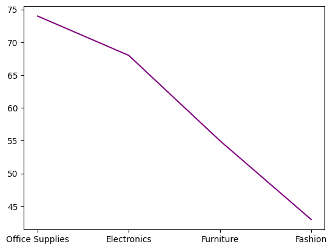
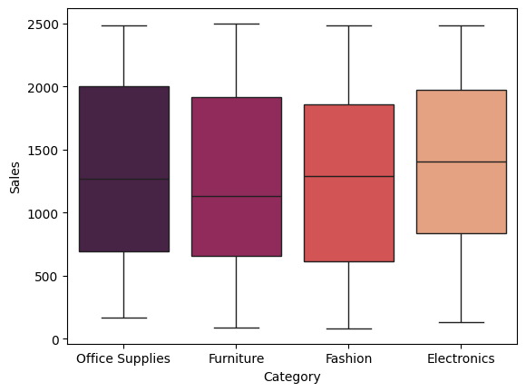
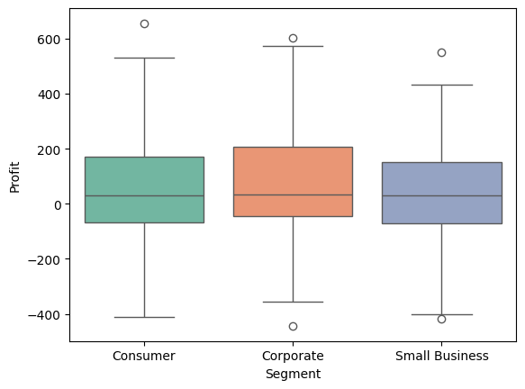

<div align="center">


# ✦ E-commerce Sales Analysis with Python ✦

**Python Data Analysis Project | Pandas · Matplotlib · Seaborn**

*Cleaning, exploring and visualising 240 e-commerce orders.*


</div>

* * *

<div align="center">

## ✦ THE TASK ✦

</div>

A practice project on an e-commerce dataset (Excel file with four sheets). The goal is to practise the full beginner workflow with Python:

1. **Load and clean:** read every sheet at once, drop the unneeded `Archive` sheet and remove duplicate records.
2. **Explore:** counts per category and sub-category, customer segments and the distribution of quantities.
3. **Visualise:** line, bar, pie, histogram, scatter and box plots.
4. **Bonus:** box plots with outlier detection using the IQR rule.

> Practice dataset used for learning. It does not describe a real company.

* * *

<div align="center">

## ✦ WHAT I PRACTISED ✦

| Library | Used for |
|:---:|:---|
| 🐼 **pandas** | `read_excel` with `sheet_name=None`, looping over DataFrames, `drop_duplicates`, `value_counts`, `describe`, `groupby`, `quantile`, `idxmax` |
| 📊 **matplotlib** | line plot, bar chart, pie chart with custom count and percentage labels |
| 🎨 **seaborn** | histogram, bar plot, scatter plot, box plots with `hue` and palettes |

</div>

* * *

<div align="center">

## ✦ KEY FINDINGS ✦

</div>

**Data cleaning:** 3 duplicate rows were removed from the orders (243 → 240 orders).

**Exploration**

- **Orders by category:** Office Supplies (74), Electronics (68), Furniture (55), Fashion (43).
- **Most ordered sub-category:** *Pens* (24 orders), followed by Phones (22).
- **Customer segments:** Consumer 129 (53.8%), Corporate 63 (26.2%), Small Business 48 (20.0%).
- **Quantity per order:** between 1 and 10 units, average 5.3 and median 5.

**Box plots (bonus)**

- **Sales:** Electronics has the highest median sales (1,406.76), but the medians of all four categories are close (1,131 – 1,407), so no category dominates the typical order value. No outliers by the IQR rule.
- **Profit:** Corporate has the highest median profit. Profit outliers appear in all three segments, mostly on orders with sales between about 2,000 and 2,450.
- **A pattern worth investigating:** Corporate and Small Business each have one **loss-making outlier in Pens** (−443.82 and −417.11), which may point to heavy discounts or high costs on large Pens orders.

* * *

<div align="center">

## ✦ CHARTS ✦

</div>

<table>
<tr>
<td align="center"><b>Orders by sub-category</b><br/></td>
<td align="center"><b>Customer distribution by segment</b><br/></td>
</tr>
<tr>
<td align="center"><b>Distribution of quantity</b><br/></td>
<td align="center"><b>Average quantity by category</b><br/></td>
</tr>
<tr>
<td align="center"><b>Sales vs. profit</b><br/></td>
<td align="center"><b>Orders by category</b><br/></td>
</tr>
<tr>
<td align="center"><b>Sales by category (box plot)</b><br/></td>
<td align="center"><b>Profit by segment (box plot)</b><br/></td>
</tr>
</table>

* * *

<div align="center">

## ✦ PROJECT UNIVERSE ✦

</div>

```
ecommerce-sales-analysis-python/
├── notebooks/
│   └── ecommerce_sales_analysis.ipynb   # the full analysis
├── data/
│   └── README.md                        # where to put the dataset
└── images/                              # chart exports
```

**Run it yourself**

```bash
pip install pandas openpyxl matplotlib seaborn
jupyter notebook notebooks/ecommerce_sales_analysis.ipynb
```

* * *

<div align="center">

## ✦ NEXT STEPS ✦

</div>

- Analyse the **Returns** sheet: return rate by category and by reason.
- Add **profit margin** (profit ÷ sales) per category and sub-category.
- Look at the **monthly trend** of orders and sales using `Order_Date`.

* * *

<div align="center">

## ✦ A LITTLE CURIOSITY GOES A LONG WAY ✦

**One insight at a time.**

[](https://www.linkedin.com/in/hager-naser/)

*Back to my [little universe](https://github.com/hagernaser622) 🪐*

</div>
